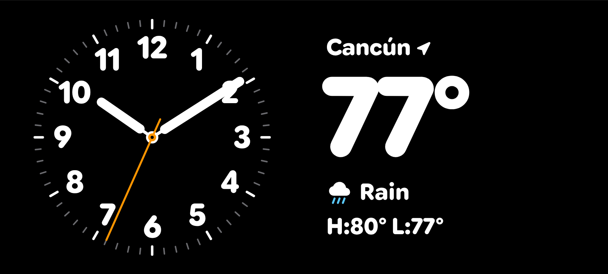
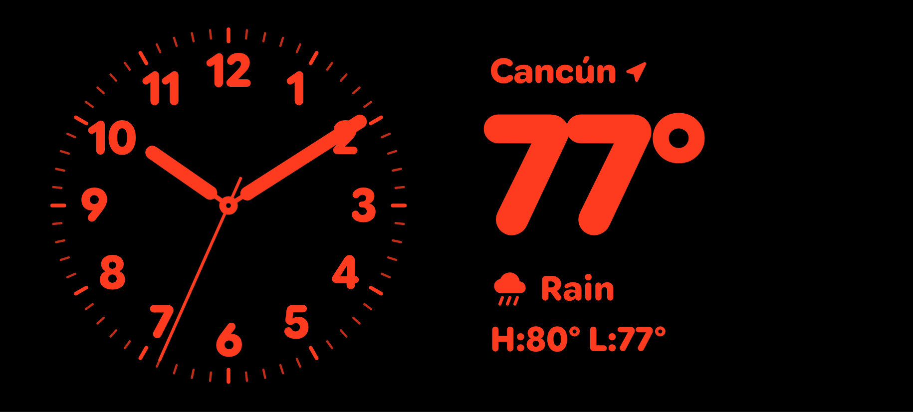
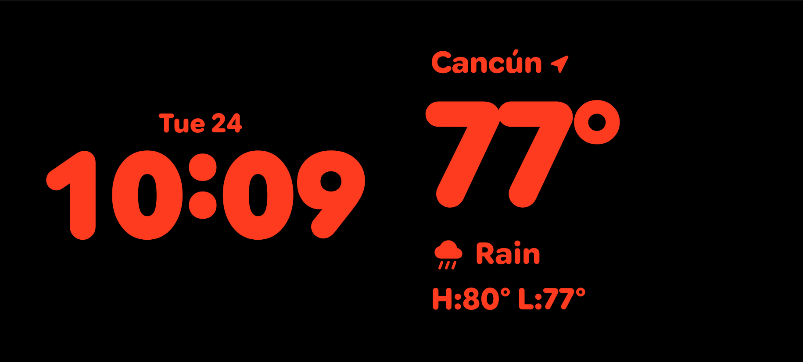

# View 02 — Clock + Weather: feasibility

Target: the iPhone StandBy "clock + weather" view. The left half shows a large analog clock (the
shared clock component). The right half shows a weather widget: `Cancún ➤`, a large `77°`,
`🌧 Rain` and `H:80° L:77°`. Night mode draws everything in one bright red (#FF3B1F) on black.

**Verdict: feasible, low risk.** Nothing here needs a backend, an API key, background location or
any special permission beyond `ACCESS_COARSE_LOCATION` and `INTERNET`. The only real unknowns are
user preferences (units, GPS vs fixed city), plus one live check of the endpoints from a network
that can reach them (see "What was verified" below).

Mockups (rendered at 915×412 CSS px @2x, the S26 Ultra landscape viewport):

| Day | Night | Digital variant (night) |
|---|---|---|
|  |  |  |

Source: [mockup.html](mockup.html). The clock is SVG generated by a small script. The font is
Google Sans Flex at weight 800 with `ROND` 100. The PNGs were rendered with Playwright, with the
font served from a local copy of the Google Fonts latin subset.

---

## What was verified vs assumed

- **Verified via web search of the official pages:** Open-Meteo terms, Google Weather pricing,
  OpenWeather pricing, the Geocoder API docs, BigDataCloud's fair-use policy, Google Sans Flex's
  licence and the Material Symbols licence. Links are below.
- **Verified locally:** Google Sans Flex's `ROND` axis and heavy weights render as intended (see
  the PNGs).
- **NOT verified live:** this sandbox's network blocks `open-meteo.com`,
  `api.open-meteo.com` and `api.bigdatacloud.net`, so no real request was made.
  - The Open-Meteo parameter names below come from my knowledge of its v1 API. They are stable
    and widely used, but treat them as *to confirm*. One `curl` on a dev machine settles it.
  - The WMO code table is the standard one that Open-Meteo documents. It was not re-fetched.
- **Assumed:** Samsung's One UI 9 ships a working `Geocoder` backend (`Geocoder.isPresent()`).
  It normally does on Play-certified Samsung phones, because the backend comes from Google Play
  services. It cannot be checked without the device, so the plan has a fallback.

---

## 1. Weather data source

| Option | Key? | Free limit | Fit |
|---|---|---|---|
| **Open-Meteo** | none | non-commercial; < 10,000 calls/day, 5,000/h, 600/min; CC BY 4.0 attribution ([terms](https://open-meteo.com/en/terms), [pricing](https://open-meteo.com/en/pricing), [README](https://github.com/open-meteo/open-meteo/blob/main/README.md)) | ✅ perfect for a personal sideloaded app |
| OpenWeather One Call 3.0 | yes, **credit card required** | 1,000 calls/day, then $0.0015/call ([One Call 3](https://openweathermap.org/api/one-call-3), [price](https://openweathermap.org/price)) | ➖ key + card for no gain |
| Google Maps Platform Weather API | yes, billing account | 10,000 "Weather Usage" events/month free ([pricing](https://developers.google.com/maps/billing-and-pricing/pricing), [usage & billing](https://developers.google.com/maps/documentation/weather/usage-and-billing)) | ➖ Cloud project + billing account |
| Samsung Weather (on device) | — | — | ❌ No public API or content provider that I could find. Samsung's widget data comes from The Weather Channel under contract. Not viable. |

**Recommendation: Open-Meteo.** It needs no key, has no account and is generous. Personal use is
exactly "non-commercial". Put the attribution "Weather data by Open-Meteo.com" in the settings/about
screen, which satisfies CC BY 4.0. It doesn't need to be on the bedside display.

One request gives everything the widget needs (to confirm live):

```
GET https://api.open-meteo.com/v1/forecast
    ?latitude=21.16&longitude=-86.85
    &current=temperature_2m,weather_code,is_day
    &daily=temperature_2m_max,temperature_2m_min
    &temperature_unit=fahrenheit        # or omit for celsius
    &timezone=auto&forecast_days=1
```

→ `current.temperature_2m`, `current.weather_code` (WMO), `current.is_day` (picks sun vs moon
icons), `daily.temperature_2m_max[0]` / `daily.temperature_2m_min[0]`. Round to whole degrees. The
JSON is small enough to parse with `org.json` and `HttpURLConnection`, so no new dependencies are
needed.

## 2. Location

- **Device location:** `LocationManager.getLastKnownLocation(FUSED_PROVIDER / NETWORK_PROVIDER)`.
  If that is null or older than about 3 h, call `getCurrentLocation(NETWORK_PROVIDER, …)`
  (API 30+). `ACCESS_COARSE_LOCATION` is enough, because weather only needs about 2 km accuracy.
  Plain `LocationManager` avoids adding the Play-services location dependency.
- **No background location needed.** The weather is fetched only while `NightstandActivity` is
  in the foreground and showing this page. An app with a visible activity counts as foreground for
  location. `ACCESS_BACKGROUND_LOCATION` is needed only for access while nothing is visible.
  - **Caveat:** if we ever want to pre-fetch from `WatcherService`, its FGS type is `specialUse`,
    not `location`. Location from that service would then need the background permission or a
    `location` FGS type. Don't do it: fetch on page show.
  - The runtime permission prompt goes in `SetupActivity`, next to the existing grants.
- **Place name (reverse geocoding):**
  1. `android.location.Geocoder`: on API 33+ use the async
     `getFromLocation(lat, lon, 1, GeocodeListener)`. Guard it with `Geocoder.isPresent()`. Take
     `locality ?: subAdminArea ?: adminArea`. It's free, needs no network contract of our own and
     returns localised names ("Cancún" with accent).
     ([Geocoder](https://developer.android.com/reference/android/location/Geocoder),
     [GeocodeListener](https://developer.android.com/reference/android/location/Geocoder.GeocodeListener))
  2. Fallback: BigDataCloud `reverse-geocode-client`. It needs no key, but its fair use only
     allows the device's own current coordinates, called from the device. That matches our use
     exactly, but stored or fixed coordinates are not allowed, and violations get an IP ban.
     ([API](https://www.bigdatacloud.com/free-api/free-reverse-geocode-to-city-api),
     [fair-use policy](https://www.bigdatacloud.com/support/fair-use-policy-for-free-client-side-reverse-geocoding-api))
  3. Open-Meteo geocoding is **forward only**, from name to coordinates
     ([docs](https://open-meteo.com/en/docs/geocoding-api)). It's the right tool for the
     **fixed-city** setting: the user types "Cancún", we store lat/lon plus the display name, and
     no reverse lookup is ever needed.
- Cache the place name with the coordinates and re-geocode only when the location moves more
  than about 5 km.

## 3. Refresh cadence, caching, network at night

- **Cadence:** fetch when the page becomes visible if the cache is older than 30 min. While the
  page stays visible, re-check every 30 min, driven by the existing per-minute tick
  (`if (now - fetchedAt > 30 min) refresh()`). That's at most 48 calls/day, a tiny fraction of
  the < 10,000 limit.
- **Cache:** store the last result (temp, code, is_day, hi, lo, place, fetchedAt, unit) in
  `SharedPreferences` as JSON. Show the cache immediately. With no network, keep showing it. If
  it's older than about 3 h, show a small "--" for the temperature, or dim the condition line.
  Never show a blank widget. Hi/lo belong to the local date, so refetch after midnight.
- **Doze / network at night:** Doze and App Standby restrict apps only while the screen is off
  and the device is idle. Nightstand is a foreground activity with the screen kept on, so it isn't
  dozing. It also already runs a foreground service and is exempt from battery optimisation per
  the README. Network should be available; this is not verified on One UI 9, so it goes on the
  on-device test list. Use a short timeout (10 s) on a background thread
  (`Executors.newSingleThreadExecutor()`) and post the result to the View.
  - If the screen sleeps in a mode where the display isn't always on, just skip refreshes. The
    next visible refresh catches up.

## 4. Condition icons (WMO code → icon)

Use **Material Symbols** (Apache 2.0, [guide](https://developers.google.com/fonts/docs/material_symbols)),
imported as Android vector drawables (Rounded style, filled, weight around 600, to match the heavy
type). Vector drawables tint to one colour with `setTint(red)`, which matches the existing
`PorterDuffColorFilter` approach in `NightstandView`. In day mode, use two-tone icons like iOS
(white cloud, blue drops, yellow sun) by layering two drawables, or keep them monochrome white.
The mockup shows two-tone in the day and monochrome red at night.

| WMO code | Meaning | Text | Material Symbol (day / night) |
|---|---|---|---|
| 0 | Clear | Clear / Sunny | `clear_day` / `clear_night` (or `sunny` / `bedtime`) |
| 1, 2 | Mainly clear, partly cloudy | Partly Cloudy | `partly_cloudy_day` / `partly_cloudy_night` |
| 3 | Overcast | Cloudy | `cloud` |
| 45, 48 | Fog, rime fog | Fog | `foggy` |
| 51, 53, 55, 56, 57 | Drizzle (incl. freezing) | Drizzle | `rainy_light` |
| 61, 63, 80, 81 | Rain, showers | Rain | `rainy` |
| 65, 82 | Heavy rain, violent showers | Heavy Rain | `rainy_heavy` |
| 66, 67 | Freezing rain | Freezing Rain | `rainy_snow` |
| 71, 73, 77, 85 | Snow, snow grains, snow showers | Snow | `weather_snowy` / `cloudy_snowing` |
| 75, 86 | Heavy snow | Heavy Snow | `snowing_heavy` |
| 95 | Thunderstorm | Thunderstorm | `thunderstorm` |
| 96, 99 | Thunderstorm with hail | Hail | `weather_hail` |

Icon names should be checked against [fonts.google.com/icons](https://fonts.google.com/icons)
when importing. Some, like `rainy_light`, `rainy_heavy`, `clear_day` and `clear_night`, are newer
additions to the set. If one is missing, use the nearest one. Bundle about 14 small XML drawables.

## 5. Font

iOS StandBy uses SF Pro Rounded (heavy). Apple's licence forbids bundling it in a non-Apple app,
so it's not an option.

| Font | Licence | Match | Notes |
|---|---|---|---|
| **Google Sans Flex** | SIL OFL 1.1 ([9to5Google](https://9to5google.com/2025/11/18/google-sans-flex-font-available/), [Google Design](https://design.google/library/google-sans-flex-font), [Fontsource](https://fontsource.org/fonts/google-sans-flex/about)) | ★★★ | Variable: `wght` up to 1000 and a `ROND` (rounded terminals) axis, which is the basis of Material 3 Expressive's rounded style. At `wght 800, ROND 100` it is very close to SF Pro Rounded Heavy. **Used in the mockup.** |
| Nunito Black | OFL | ★★ | Rounded, but its numerals are friendlier and narrower. A good fallback, at about 17 KB for the latin subset. |
| Device fonts (One UI's SamsungOne, Roboto) | not bundleable or not rounded | ★ | SamsungOne is not rounded. Roboto Flex has no rounded axis. |

**Recommendation:** bundle `GoogleSansFlex` (the variable TTF in `res/font/`, a few hundred KB; it
can be subset to latin with `pyftsubset`). Apply it with `Paint.setTypeface(...)` and
`Paint.setFontVariationSettings("'wght' 800, 'ROND' 100")` (API 26+). This one font serves the
clock numerals, the weather text and the digital variant. Include the OFL licence text in
`assets/licenses/`.

**Colour:** night = `#FF3B1F` at full intensity. The mockup confirms it reads as the bright
orange-red of the photo. Note that the existing `NightstandView` uses `0xFFB3241B` (dim maroon)
unless `nightBoost` is set, so the page should take its colour from one shared palette rather than
hard-code it.

---

## Open questions for the user

1. **°F or °C?** The photo shows °F. Options: follow the system locale/region setting
   (`LocalePreferences.getTemperatureUnit()` on API 34+), or a toggle in settings.
2. **GPS or a fixed city?** Options: (a) device location with a coarse permission, (b) a city
   typed in settings, or (c) GPS with a fixed-city override. I suggest (c), defaulting to GPS.
3. **Show the location arrow ➤ only when the location is from GPS?** That's what iOS does.
4. **Day icons two-tone (iOS-like) or monochrome white?**
5. **Analog or digital on this page,** or both as separate pages in the pager?
6. Is a ~300 KB bundled font acceptable? (Assumed yes, since the app is sideloaded.)

## Implementation plan (later)

**Permissions (manifest):** `INTERNET`, `ACCESS_COARSE_LOCATION`. No background location, no new
FGS type. Add a "Location for weather" step to `SetupActivity`, skippable when a fixed city is
set.

**Classes (Kotlin, plain Views):**

- `weather/WeatherSnapshot.kt`: data class
  `(tempNow: Int, code: Int, isDay: Boolean, hi: Int, lo: Int, place: String, fromGps: Boolean, unit: Unit, fetchedAt: Long)`
  with `toJson()` / `fromJson()`.
- `weather/WmoCodes.kt`: a pure function `code → (labelRes, iconDayRes, iconNightRes)`. Unit-test
  it like `TriggerPolicy`.
- `weather/OpenMeteoClient.kt`: builds the URL, `HttpURLConnection` with a 10 s timeout, and
  parses with `org.json`. The parser is pure and unit-tested against a saved JSON fixture.
- `weather/LocationResolver.kt`: fixed city from `Prefs`, or last-known/current coarse location.
  Then `Geocoder` (async, API 33+) with a BigDataCloud fallback. Caches the place and its
  coordinates.
- `weather/WeatherRepository.kt`: owns the cache in `SharedPreferences`, the staleness rules
  (30 min refresh, 3 h stale, date rollover) and a single-thread executor. Exposes
  `current(): WeatherSnapshot?` and `refreshIfStale(onResult)`.
- `pages/ClockWeatherPage.kt`: a `View` (or `FrameLayout`) with `var night: Boolean` and
  `fun onMinuteTick(now)`.
  - **Left:** the parent's `AnalogClockView` component, sized to `min(h, w/2) * 0.9`.
  - **Right:** weather drawn on `Canvas` with `StaticLayout`/`Paint`, using the font sizes from
    the mockup scaled by height: location about 8% of h, temperature about 41%, condition and
    hi/lo about 8%.
  - The icon is a tinted `VectorDrawable`.
  - On attach or page selected, it calls `repo.refreshIfStale { invalidate() }`. On each tick it
    calls the same, which is a no-op unless stale.
- `Prefs`: add `tempUnit`, `weatherCity` (name + lat/lon, or null for GPS) and `weatherEnabled`.
- Settings: a city search through the Open-Meteo geocoding `search?name=` endpoint, and an
  attribution line.

**Tests:** WMO mapping, the JSON parser (fixture), staleness and rollover logic, and unit
conversion if done client-side. On the device, check: Geocoder present, network available at night
with the screen on, and the permission prompt flow.
